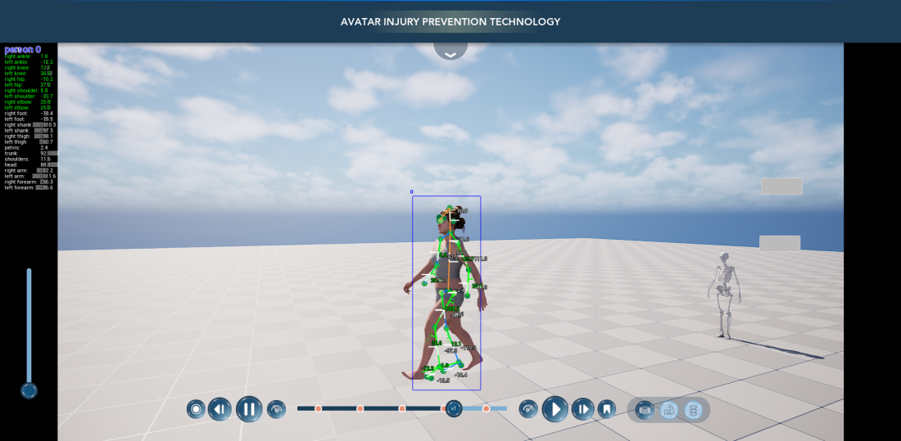
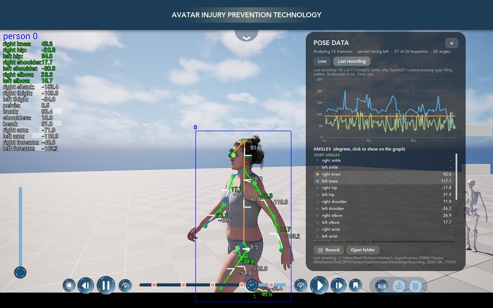

# MetaHumanTest — Pose Estimation

A **Sports2D-style pose estimation** built inside the *MetaHumanTest* Unreal Engine 5.8 project (LSU DMAE, Avatar Injury
Prevention Technology). It finds the person in the live 3D view, draws Sports2D's skeleton, angle arcs and angle list
over the MetaHuman, and computes Sports2D's 26 joint and segment angles. A data panel shows the angles live and as
graphs; recordings are post-processed like Sports2D (gap filling, outlier removal, Butterworth filter) and saved in
Sports2D's `.mot` / `.trc` formats plus a CSV. The last phase adds the on-screen buttons.

It is a C++ rebuild of [Sports2D](https://github.com/davidpagnon/Sports2D): **the same two AI models** (YOLOX-m +
RTMPose-m, "balanced" mode), **the same image preparation** (ported from [RTMLib](https://github.com/Tau-J/rtmlib)) and
**the same rules and angle formulas** (from Sports2D / [Pose2Sim](https://github.com/perfanalytics/pose2sim)), run by
Unreal's Neural Network Engine (ONNX Runtime, CPU, so it also runs on Mac).





**Full documentation:** [README/08_Pose_Estimation.md](../README/08_Pose_Estimation.md): how it works step by step,
the files, settings, the tests against Sports2D, speed, and a dated work log.

## Status

| Phase | What | State |
|---|---|---|
| 1 | Models running in Unreal on the live view, checked against Sports2D | Done: keypoints identical to RTMLib (99.5 % exact, max 1.2 px) |
| 2 | Sports2D-style overlay + the 26 angles | Done: angles identical to Sports2D's own functions; ~11 frames analysed per second |
| 3 | Angles over time: filtering, data panel with graphs, export (CSV, `.trc`, `.mot`) | Built: post-processing identical to Sports2D / Pose2Sim's own functions (within 0.0001°); waiting for a test in Play |
| 4 | The two round buttons (Pose Overlay, Pose Data) | To do |

## What this repository contains

This repo holds **only the pose estimation work**. The rest of the Unreal project (MetaHuman, UI, levels) is in Perforce
and in [mblumpkin/MetaHumanTest](https://github.com/mblumpkin/MetaHumanTest). The paths are the project's own, so the
files drop straight into it.

| Path | What |
|---|---|
| `Source/MetaHumanTest/Public/PoseEstimation/`, `Source/MetaHumanTest/Private/PoseEstimation/` | All the C++: estimator (models + RTMLib pre/post-processing), Sports2D rules and angles, frame grabber, inference thread, component, overlay, post-processing (`PoseSignal`), recording and export (`PoseRecording`), data panel, test commandlet |
| `Source/MetaHumanTest/MetaHumanTest.Build.cs`, `Source/MetaHumanTest.Target.cs`, `Source/MetaHumanTest/CPP_PlayerController.h/.cpp`, `MetaHumanTest.uproject` | The project files the feature touches (modules, model staging, the component on the player controller, the NNERuntimeORT plugin) |
| `PoseModels/` | The two ONNX models (Git LFS), where they come from, checksums, licences |
| `Tools/PoseEstimation/` | `parity_check.py` (keypoints vs RTMLib), `sports2d_reference.py` (angles / drawing vs Sports2D) and `postprocessing_check.py` (filtering vs Sports2D / Pose2Sim) |
| `README/08_Pose_Estimation.md`, `README/images/pose_*.png` | The documentation |

Also needed in `Config/DefaultEngine.ini` (not tracked here):
```ini
[/Script/EngineSettings.GameMapsSettings]
GameDefaultMap=/Game/Main.Main

[/Script/NNERuntimeORT.NNERuntimeORTSettings]
GameThreadingOptions=(bUseGlobalThreadPool=False,IntraOpNumThreads=4,InterOpNumThreads=1,ExecutionMode=SEQUENTIAL)
```

## Try it

In the editor: **Play**, then in the console (**`**) `Pose.Enable 1` for the overlay and `Pose.Data` for the data
panel. Record with the timeline's Record button (or `Pose.Record`); recordings go to
`Saved/PoseEstimation/Recordings/`. Other commands: `Pose.Overlay`, `Pose.Stats`, `Pose.Dump`, `Pose.TestImage <png>`.
Buttons come in phase 4.

## Credits and licences

* Models: [OpenMMLab RTMPose / MMPose](https://github.com/open-mmlab/mmpose/tree/main/projects/rtmpose), Apache 2.0.
* Pre/post-processing ported from [RTMLib](https://github.com/Tau-J/rtmlib), Apache 2.0.
* Rules, settings, keypoint set and angle definitions from [Sports2D](https://github.com/davidpagnon/Sports2D) and
  [Pose2Sim](https://github.com/perfanalytics/pose2sim), BSD 3-Clause, by David Pagnon et al.

Their licence texts are in [`PoseModels/LICENSES/`](../PoseModels/LICENSES).
