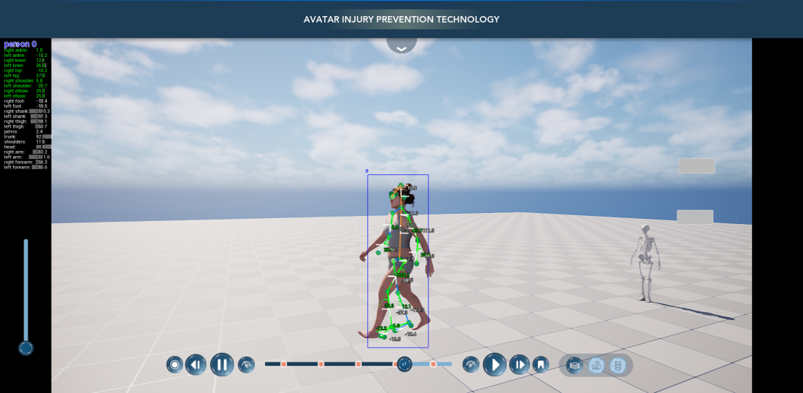
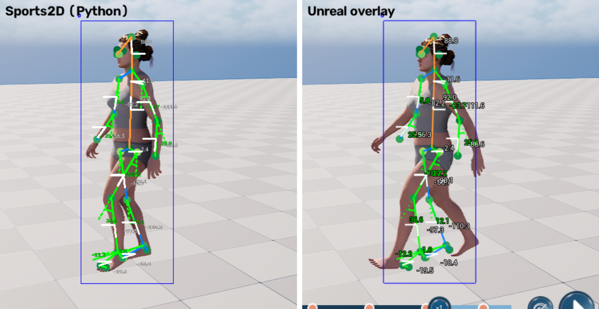
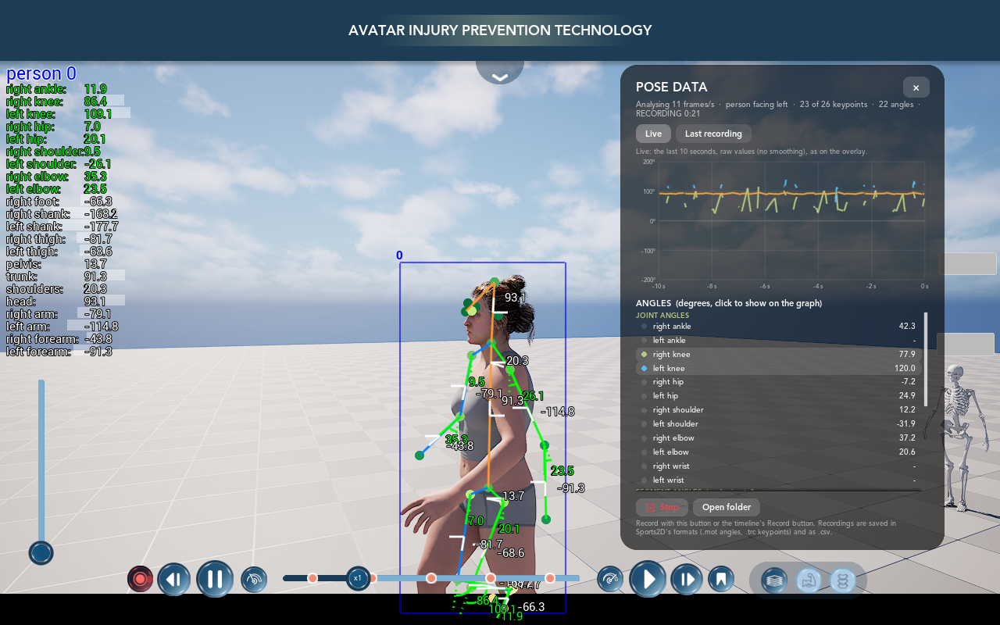
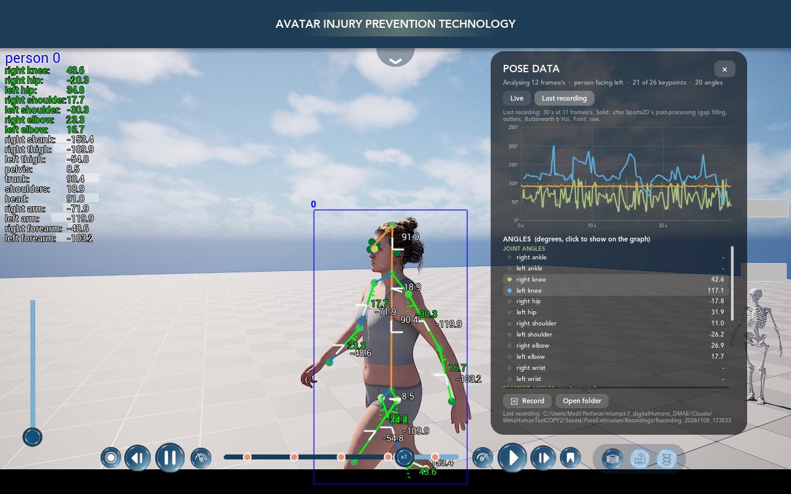
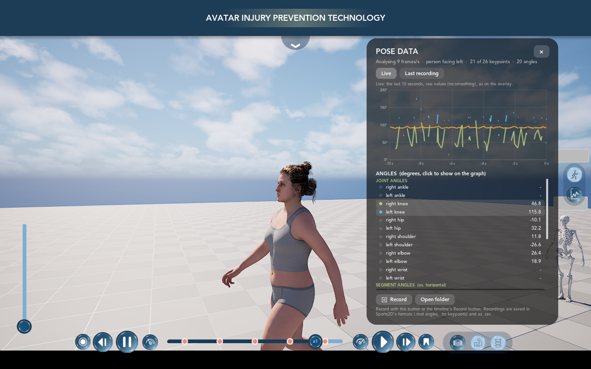

# 08 — Pose estimation (Sports2D inside Unreal)

The goal: a **Sports2D-style pose estimation** that runs inside the project. It finds the person in the 3D view, draws their
skeleton over the MetaHuman, and shows the joint-angle data in its own panel. Two round buttons on the right of the
screen (styled like the layer switcher) switch it on: **Pose Overlay** on top, **Pose Data** underneath.

[Sports2D](https://github.com/davidpagnon/Sports2D) is the outside tool the team used until now. This is a rebuild of
it in C++: **the same two AI models, the same image preparation and the same rules**, so the numbers match what
Sports2D gets from the same picture.


*Play-In-Editor with the overlay on (phase 2): box, keypoints, skeleton, angle arcs and values on the body, and the list
of all angles on the left. The anatomy skeleton on the right is also detected as a person, but Sports2D's rules reject
it, so nothing is drawn on it.*

Phase 3 adds the **Pose Data** panel (angle values and graphs) and **recording**: press the timeline's Record button
and the angles and keypoints are smoothed the way Sports2D does it and saved in Sports2D's file formats plus a
spreadsheet ([pictures](#10-the-pose-data-panel-cpp_uw_posedatapanel)). Phase 4 adds the two buttons, so no console is
needed ([picture](#11-the-two-buttons-cpp_uw_posebuttons)).

- [Status](#status)
- [Try it](#try-it)
- [How it works](#how-it-works)
- [The files](#the-files)
- [Settings](#settings)
- [How we know it matches Sports2D](#how-we-know-it-matches-sports2d)
- [Speed](#speed)
- [Things to know](#things-to-know)
- [Changes outside the new folder](#changes-outside-the-new-folder)
- [Work log](#work-log)
- [Source code on GitHub](#source-code-on-github)
- [Credits and licences](#credits-and-licences)

---

## Status

| Phase | What | State |
|---|---|---|
| 1 | Models running in Unreal on the live view + basic dot overlay, checked against Sports2D | **Done** (2026-11-08) |
| 2 | Sports2D-style overlay: skeleton lines, confidence colours, angle arcs on the joints, list of angle values; the 26 angles | **Done** (2026-11-08): drawing and angles match Sports2D; steady ~11 frames analysed per second |
| 3 | Angles over time: filtering (Butterworth 6 Hz), data panel with graphs, export (CSV + Sports2D's `.trc` / `.mot`) | **Done** (2026-11-08): post-processing matches Sports2D / Pose2Sim; data panel and recording work in the standalone game and in Play |
| 4 | The two round buttons on the right (Pose Overlay, Pose Data) | **Done** (2026-11-08): right place, same look as the layer switcher, tested in Play |

Decisions so far:
* **Image route.** The models look at the rendered picture, like Sports2D looks at a video. They do *not* read the
  MetaHuman's bones. This keeps Sports2D's behaviour, including its occasional mistakes.
* **"Balanced" models**, Sports2D's default (YOLOX-m + RTMPose-m, 26 keypoints "HALPE_26").
* **CPU only**, so it also runs on Mac. A faster Windows-only GPU option can be added later.
* **Live**: it analyses the view while the animation plays.

---

## Try it

Everything is on screen; no console needed (this is what coaches and trainers use):

1. Press **Play**. Two round buttons sit on the right edge of the screen, halfway down
   ([step 11](#11-the-two-buttons-cpp_uw_posebuttons)).
2. **Pose Overlay** (top, stick figure): shows the Sports2D skeleton, angle arcs and the list of angles on the
   MetaHuman. The first time, the models load in the background (about 1–2 s), then the drawing appears. Click again to
   hide it.
3. **Pose Data** (below, graph): opens the **Pose Data** panel: the angle values, a graph of the last 10 seconds and the
   Record button ([step 10](#10-the-pose-data-panel-cpp_uw_posedatapanel)). It works with the overlay on or off.
   Click again (or the panel's **×**) to close it.
4. To **record**, press the timeline's red **Record** button (or **Record** in the panel, which presses the timeline's
   button for you). Press it again to stop. The recording is processed like Sports2D does it, saved in
   `Saved/PoseEstimation/Recordings/Recording_<date>_<time>/`, and the panel switches to **Last recording** to show it.
   **Open folder** in the panel shows the files.

A button is **dark with a white icon when on**, light blue when off, like the layer buttons. Hovering shows what it does
(and, the first time, that the models are loading).

**Console** (for testing and debugging): during Play, click in the game view and press **`** (the key left of 1). The
**Cmd** box at the bottom of the Output Log also works.

| Command | Does |
|---|---|
| `Pose.Enable 1` / `0` (no number = toggle) | Start / stop analysing the view and the overlay (= the **Pose Overlay** button) |
| `Pose.Overlay 1` / `0` | Show / hide the drawing (the analysis keeps running) |
| `Pose.Data 1` / `0` (no number = toggle) | Open / close the Pose Data panel (= the **Pose Data** button) |
| `Pose.Record` | Start / stop a recording, same as the timeline's Record button |
| `Pose.Stats` | Writes one line to the Output Log, averaged over the last 3 s: frames analysed per second and the game's fps, image size, time in each model, where the rest of the time goes (copying the frame, waiting, analysing), copy timeouts, people found, and for the main person: valid keypoints, mean score, the side facing the camera, number of angles |
| `Pose.Dump` | Saves the next analysed frame in `Saved/PoseEstimation/`: the image (PNG), the keypoints (JSON), the people kept + angles (`.sports2d.json`) and a screenshot with the overlay (`_screen.png`). The first screenshot can freeze the game for a few seconds (Unreal compiles a few shaders for it) |
| `Pose.TestImage <file.png> [out.json]` | Runs both models on an image file (Play not needed) and writes the keypoints as JSON |

If no result arrives for 1.5 s while it's on, a line starting *"Pose estimation: no result for"* appears in the Output
Log, describing what each stage is doing at that moment (the *watchdog*). Send that line to whoever is debugging.

**Hands-free test** (editor closed): run the game on its own with pose estimation switched on, stats logged every 5 s,
quitting after 75 s, all written to `Saved/Logs/PoseAutoTest.log`:
```
"C:/Program Files/Epic Games/UE_5.8/Engine/Binaries/Win64/UnrealEditor.exe" <project>/MetaHumanTest.uproject /Game/Main -game -windowed -PoseAutoEnable -PoseLogStats=5 -PoseQuitAfter=75 -log=PoseAutoTest.log
```
More switches for testing phase 3 the same way:

| Switch | Does |
|---|---|
| `-PoseDataPanel` | Open the Pose Data panel at start |
| `-PoseRecordAfter=20 -PoseRecordFor=30` | Press Record 20 s after the start, and again 30 s later |
| `-PoseScreenshotEvery=10` | A screenshot with the HUD every 10 s, in `Saved/PoseEstimation/Screenshots/auto_01.png`, … |

For example, the run that made the two panel pictures below:
```
... MetaHumanTest.uproject /Game/Main -game -windowed -ResX=1650 -ResY=928 -PoseAutoEnable -PoseDataPanel -PoseRecordAfter=20 -PoseRecordFor=30 -PoseScreenshotEvery=20 -PoseLogStats=5 -PoseQuitAfter=75 -log=PoseAutoTest.log
```
None of the `-Pose…` switches do anything unless they're on the command line.

From C++ or Blueprint: the player controller's **Pose Estimation** component (`GetPoseEstimation()`) has
**Set Estimation Enabled**, **Set Overlay Visible**, **Set Data Panel Open**, **Toggle Recording** (what the panel's
Record button calls), **Start / Stop Recording** (without touching the timeline), **Is Recording**, **Get Recording
Seconds**, **Get Last Recording Folder**, **Get Latest Result**, **Get Stats Text**, and the events **On Pose
Estimated** (after every analysed frame, with all the keypoints and angles) and **On Recording Saved** (with the
folder). Phase 4's buttons only need *Set Estimation Enabled* and *Set Data Panel Open*.

---

## How it works

```
 game thread                 render thread                         worker thread
 ───────────                 ─────────────                         ─────────────
 PoseEstimationComp ──1──►  PoseFrameGrabber: copy the finished
 "I want the next frame"     3D image (before the HUD is drawn)
                             to a CPU-readable texture
                     ◄──2──  pixels ready
 launch analysis ────────────────────────────────────────────3──►  PoseEstimator:
                                                                    a) YOLOX finds people (every 4th frame)
                                                                    b) RTMPose finds 26 keypoints per person
                                                                    c) Sports2D's rules keep / reject people,
                                                                       which way they face, their 26 angles
 overlay + OnPoseEstimated ◄─────────────────────────────────4───  result
```

One frame is analysed at a time, on a thread of its own (`PoseInferenceThread`), so the game never waits for the
models. While they work, the next frame is copied, timed to be ready just as they finish (see [Speed](#speed)).

### 1. Getting the picture: `PoseFrameGrabber`
Sports2D reads frames from a video. Here the frame is **the image the player is looking at**. When a frame is
requested, a hook in the renderer (a *scene view extension*) copies the finished 3D image of the game viewport into a
small CPU-readable texture. A few frames later, once the GPU is done, the pixels are handed over.
* It is copied **after** lighting, exposure and anti-aliasing, and **before** the UMG HUD is drawn on top. So the
  models see exactly what you see, without the menus and without our own dots.
* Why not a second camera ("scene capture")? That would render the MetaHuman scene a second time (expensive), and the
  hair and anti-aliasing would look different from the screen.
* The copy costs nothing when pose estimation is off: the hook only switches on for the frame that was requested.

### 2. Finding the person: YOLOX-m (`FPoseEstimator::Detect`)
The same steps as RTMLib (the library Sports2D uses):
1. Shrink the image to fit 640 × 640, keeping its shape, top-left aligned. Fill the rest with grey (114).
2. Run the model. It returns boxes around people, each with a score.
3. Keep boxes with a score above 0.3, then scale them back to the full image.

### 3. Finding the keypoints: RTMPose-m (`FPoseEstimator::EstimatePose`)
For each person box:
1. Make the box 25 % bigger and widen or heighten it to the model's 3:4 shape.
2. Cut that area out and resize it to 192 × 256 (an *affine warp*), then normalise the colours.
3. Run the model. For each of the 26 keypoints it returns two lists of numbers (*SimCC*): one along x (384 values) and one
   along y (512 values). The position of the highest value in each list is the keypoint's position, at half-pixel
   steps. The keypoint's **score** is the average of the two highest values.
4. Convert back to image pixels.

The 26 keypoints (HALPE_26): nose, eyes, ears, shoulders, elbows, wrists, hips, knees, ankles, head, neck, hip
(centre), big toes, small toes, heels.

### 4. Following the person between detections
Like Sports2D (`det_frequency = 4`), the person detector only runs **every 4th analysed frame**. On the frames in
between, each person's box is the box around their keypoints from the previous frame, made 25 % bigger. This saves a lot of
time: the detector is the slow model.

### 5. Sports2D's rules
Straight from Sports2D's `process.py`, with its default settings:
* People whose average score over all 26 keypoints is 0.2 or less are dropped. Overlapping people are merged (pose-level
  NMS at 0.45 overlap), best score first.
* Keypoints with a score **below 0.3** are ignored (*keypoint likelihood threshold*). Sports2D does not draw or use
  them.
* A person is kept only if **at least 30 %** of their keypoints are valid (*keypoint number threshold*) **and** those
  keypoints average **0.5 or more** (*average likelihood threshold*). That is why the skeleton model in the picture
  above is rejected.
* The **main person** is the first person kept (the highest score).

### 6. Angles: `PoseSports2D`
The same 26 angles as Sports2D's default settings, with Pose2Sim's definitions (keypoints, offset, sign):

| Joint angles (12) | Segment angles (14), measured against the horizontal |
|---|---|
| right / left **ankle** (dorsiflexion: knee–ankle vs. toe–heel, +90°) | right / left **foot** (big toe – heel) |
| right / left **knee** (flexion: ankle–knee–hip, −180°) | right / left **shank** (ankle – knee) |
| right / left **hip** (flexion: knee–hip vs. hip centre–neck) | right / left **thigh** (knee – hip) |
| right / left **shoulder** (flexion: elbow–shoulder vs. hip centre–neck) | **pelvis** (left hip – right hip), **shoulders** (left – right shoulder) |
| right / left **elbow** (flexion: wrist–elbow–shoulder, +180°, sign flipped) | **trunk** (neck – hip centre), **head** (head – neck) |
| right / left **wrist**: *never available*, the 26-point model has no finger point (Sports2D shows nothing either) | right / left **arm** (elbow – shoulder), **forearm** (wrist – elbow) |

* **Which way the person faces** (*visible side*, setting **Auto**): on every frame, if the feet point right on screen
  (heel → big toe), the person "faces right"; otherwise "left", and the x positions are mirrored before computing the
  angles so a knee bend reads the same either way. As in Sports2D, if any foot keypoint is missing the answer is
  "left".
* An angle is only computed when all its keypoints are valid (score ≥ 0.3); otherwise it is missing on that frame.
* Results are wrapped to −180…180° (pelvis and shoulders: −90…90°).
* Every frame's angles are in the result (`FPosePerson::Angles`, usable from Blueprint) for the phase 3 data panel.

### 7. The overlay: `CPP_UW_PoseOverlay`
A see-through widget over the whole screen, between the 3D view and the HUD (Z-order 5; the HUD is 10). Clicks pass
through it, so orbit, pan and muscle picking still work. It is pure C++ (drawn in `NativePaint`), so it needs no Widget
Blueprint. It draws what Sports2D's real-time display draws, in the same order, ported from its drawing functions:

1. **Box** around each person's valid keypoints (25 px margin), one colour per person, with their number.
2. **Keypoints**: dots coloured with Sports2D's colour map (*RdYlGn*: red = unsure, green = sure).
3. **Skeleton**: right-side bones blue, left-side green, the middle (head, neck, spine) orange.
4. **Angles**:
   * segment angles in **white**: a short line along the segment and a horizontal reference line;
   * joint angles in **green**: a line along the segment, the parent segment dotted, and an arc between them;
   * each value written next to it (*on the body*), and all values listed as "name: value" with a bar (50 px per 180°)
     (*the list*).


*Left: real Sports2D's drawing functions run on a frame copied from Play. Right: the Unreal overlay with the result of
that same frame. The lines, colours and numbers are the same. The MetaHuman underneath has moved on a little because the
screenshot was taken a moment later: the overlay always shows the most recent result, which is a few frames old.*

Sizes are Sports2D's, in pixels of the analysed image (= the screen), so it looks like a Sports2D video of the same size,
except the text: Sports2D's default *fontSize* 0.3 was hard to read on screen, so the overlay uses **0.4** (a third
bigger; the list spacing grows with it). *Font Size* and *Size Scale* on the overlay change this.
Sports2D puts the list in the image's top-left corner; here it starts below the HUD title bar (*List Position*).

### 8. Recording: `PoseRecording`
While a recording runs, every analysed frame adds one *sample* for the main person: the time, their 26 keypoints
(image pixels) and their 26 angles (missing ones left empty). If nobody passes Sports2D's rules on a frame, the sample is
empty. The analysis keeps running for the whole recording, even with the overlay and the panel off.

**Starting and stopping.** The recording follows the timeline's **Record** button (setting *Record With Timeline*), so
the video recording and the pose data always cover the same time. The panel's Record button and `Pose.Record` press the
timeline's button. Without a timeline (or with the setting off), they record on their own.

**From live frames to "video frames".** Sports2D works on a video: frames at a fixed rate. Live analysis gives ~11
frames a second, but not exactly evenly spaced (one every 80–100 ms). So when the recording stops:
1. The *frame rate* is the samples' average rate: (number of samples − 1) / duration.
2. An even time grid at that rate is laid from the first to the last sample. It has as many steps as there are
   samples. Each step takes the **nearest** sample, so every analysed frame is used once, moved by less than half a
   step (< ~45 ms) in time.
3. From then on, each angle and each keypoint coordinate goes through Sports2D's post-processing (step 9) exactly as if
   it came from a video at that frame rate.

Why the nearest sample and not a straight line between neighbours? A straight line needs both neighbours. When a
keypoint flickers in and out (often the knee on the far side), almost every value would be lost. The first try did
this and lost most of the knee values.

**What is saved**, in `Saved/PoseEstimation/Recordings/Recording_<yyyyMMdd_HHmmss>/` (Sports2D's file names, *person00*
= the main person):

| File | What | Opens in |
|---|---|---|
| `…_Sports2D_angles_person00.mot` | The post-processed angles, one column per angle that was seen at least once; degrees | OpenSim, any text editor; Sports2D's own format, so its plotting tools read it |
| `…_Sports2D_px_person00.trc` | The post-processed keypoints: 22 markers in Sports2D's order (no eyes or ears), in image pixels (x right, y down). Sports2D's `_px.trc` format; like Sports2D, the header says "m" even though the values are pixels | OpenSim, Mokka, any text editor |
| `…_angles.csv` | Time, then each of the 26 angles twice: post-processed, and *(raw)* = before the post-processing (on the even grid, unwrapped) | Excel, Google Sheets, Python |

Empty cells mean "no value" (the angle couldn't be measured there, and the gap was too long to fill).

### 9. Sports2D's post-processing: `PoseSignal`
Ported from Sports2D's `process.py` and Pose2Sim's `common.py` / `filtering.py`, with Sports2D's default settings.
It runs on each angle and each keypoint coordinate separately, in this order:

| Step | What it does | Sports2D / Pose2Sim function |
|---|---|---|
| 0. Unwrap (angles only) | Removes jumps of 180° or 360° where a value crosses ±180°, then moves the whole curve by a multiple of 360° so its average is between −180° and 180° | `np.unwrap(period=180)` in `process.py` |
| 1. Fill short gaps | Gaps of up to **100 frames** are filled with a straight line. Nothing is added before the first or after the last value. (Zeros also count as gaps, as in Pose2Sim.) | `interpolate_zeros_nans` |
| 2. Trim and fill long gaps | Keeps the data from the first to the last run of at least **10** valid frames. Longer gaps inside are filled with the last value before the gap | `indices_of_first_last_non_nan_chunks`, `fill_large_gaps_with = 'last_value'` |
| 3. Outliers | Each value further than 2 *sigma* from the median of its window is replaced by that median (*Hampel filter*). Window: **7 frames** for angles; for keypoints 7 × frame rate / 30 (3 frames at 11 frames/s) | `hampel_filter` |
| 4. Smoothing | Zero-phase **Butterworth** low-pass, 4th order, **6 Hz** (run forwards and backwards so the curve isn't delayed) | `butterworth_filter_1d` (scipy `butter` + `filtfilt`) |

**The cut-off at ~11 frames/s.** A 6 Hz filter needs more than 12 frames a second. Sports2D has a rule for this when it
analyses a webcam: if the cut-off isn't below half the frame rate, it uses half the frame rate instead (frame rate / 2.001).
Then Pose2Sim rounds it down to whole Hz. At 11 frames/s that gives **5 Hz**, which the panel and the log show. At 12
frames/s or more it's 6 Hz again.

Everything is computed in double precision with the same formulas as numpy, scipy and pandas (including small quirks,
such as the filter's start-up values and pandas' slices that include their last element), so the results match the
Python code to within 0.0001° (see the [tests](#how-we-know-it-matches-sports2d)).

### 10. The Pose Data panel: `CPP_UW_PoseDataPanel`


*Live, while recording (top line: RECORDING 0:21). The graph shows the last 10 s of the right knee (green), left knee
(blue) and trunk (orange), raw, as on the overlay. The MetaHuman faces left, so the camera sees its right side: the
right knee bends and straightens with each step, while the left knee (the far-side leg) is mostly hidden and only shows
up now and then, as separate ticks.*


*After the recording: the same three angles over the whole 30 s, after Sports2D's post-processing. The right knee
(green) shows the steps. The left knee (blue) is the hidden leg: its few values are unreliable, gaps were filled, and
the unwrapping lifted some above 180° ([things to know](#things-to-know)). (This picture was taken before a small fix:
its caption says 6 Hz, but 5 Hz was used at 11 frames/s; the caption now says so.)*

The panel is docked on the right, in the HUD's style (the dark rounded background of the other panels, Avenir fonts),
so the MetaHuman and the overlay stay visible. It is drawn in C++, like the overlay, so it needs no Widget Blueprint.
Clicks outside the panel go through to the scene as before. From top to bottom:
* **Title** and **×** (close).
* **Status line:** frames analysed per second, which way the person faces, valid keypoints, angles measured, and
  *RECORDING m:ss* while recording.
* **Live / Last recording.** *Live*: the last 10 s, raw values exactly as on the overlay, at the times they were
  analysed; gaps where there was no value; a value alone between gaps is drawn as a short tick. *Last recording*: the
  whole last recording, post-processed (solid lines) over the raw values (faint), like Sports2D's angle plots. The panel
  switches to it on its own when a recording has been saved.
* **The graph**, in degrees over seconds.
* **The 26 angles**, as *joint* and *segment* angles, with their current value ("-" when not measured). Click a row
  to put that angle on the graph or take it off (up to 4 at once, each with its own colour). Right knee, left knee and
  trunk are shown at first. *Right / left wrist* never have a value: the 26-keypoint model has no finger point (see
  [step 6](#6-angles-posesports2d)).
* **Record / Stop** (presses the timeline's Record), **Open folder** (opens the last recording's folder in Explorer, or
  the Recordings folder if there is none yet), and where the last recording was saved.

Opening the panel starts the analysis (closing it stops it again, unless the overlay is on or a recording is running).

### 11. The two buttons: `CPP_UW_PoseButtons`


*Standalone game, Pose Data open (its button is dark) and the overlay off (its button is light). Compare with the
layer switcher at the bottom right: same circles, same pill.*

Two round buttons in a see-through pill on the right edge of the screen, vertically centred: **Pose Overlay** on top,
**Pose Data** underneath. They copy the layer switcher (Body / Muscles / Skeleton) exactly:
* **Pictures:** the same glossy 46 px circles, cut from the same Figma pictures with their icons removed, with new icons
  drawn in the same line width and colours: a stick figure with joint dots (overlay) and a line graph (data). On = dark
  circle with a white icon, off = light-blue circle with a navy icon, like a selected / unselected layer button. Made by
  `Tools/PoseEstimation/make_pose_button_textures.py`; putting the Body icon back on the empty circles gives Figma's
  picture to within 1 grey level on average, so the circles are the real ones.
* **Pill:** `#1D3C55` at 26 %, fully rounded, 65 px wide (the layer switcher's pill, standing up); buttons 58.88 px
  apart, as on the layer switcher. Clicks between the buttons don't reach the 3D view; everywhere else on the screen
  they pass through as before.
* **Hover / press:** brighter (×1.15) / darker (×0.8), as on the layer and timeline buttons. Clicking doesn't take
  keyboard focus, so the camera keys and the console key keep working.
* **What they do:** **Pose Overlay** = `SetEstimationEnabled` (analysis + drawing), **Pose Data** = `SetDataPanelOpen`.
  Each button reads the component's state every frame, so it stays right however the state changes (the panel's ×,
  the console, Blueprint).
* **Tooltips** say what each button does, *"Loading the pose models…"* while they load, and why it can't start if the
  model files are missing.

The pose component creates the buttons when Play starts (*Show Buttons* setting), at Z-order 11: above the HUD (10),
below the muscle popup (20). They are drawn in C++, so they need no Widget Blueprint. The data panel stops 96 px
from the right edge, so the buttons stay visible next to it.

---

## The files

All new code is in `Source/MetaHumanTest/Public/PoseEstimation/` (headers) and `…/Private/PoseEstimation/` (code).

| File | What it does |
|---|---|
| `PoseTypes.h/.cpp` | The data: `EPoseKeypoint` (the 26 names), `FPoseKeypoint` (position in the image, position on screen, score, valid), `FPoseAngle`, `EPoseVisibleSide`, `FPosePerson` (keypoints, angles, side faced), `FPoseFrameResult` (everyone found in one frame + timings). Also the skeleton bone pairs from Pose2Sim. Usable from Blueprint. |
| `PoseSports2D.h/.cpp` | Sports2D's per-frame rules ported from `process.py` / Pose2Sim: which people are kept, which side they face, and the 26 angles (`GetAngleDefinitions`, `ComputeAngle`, `BuildFrameResult`). Plain functions, shared by the live component, the command-line test and (phase 3) the data panel. |
| `PoseInferenceThread.h/.cpp` (Private) | A dedicated thread that runs one analysis at a time, so the models never queue behind other editor work. |
| `PoseEstimator.h/.cpp` | **The core.** Loads the two `.onnx` models into Unreal's Neural Network Engine (ONNX Runtime, CPU) and runs them, with RTMLib's preparation and decoding ported line by line: `Detect`, `EstimatePose`, `ProcessFrame` (the every-4th-frame logic), `ResizeLinear` / `WarpAffineLinear` (copies of OpenCV's image resizing), plus PNG/JSON helpers for tests. Not tied to the game, so tests can run it on image files. |
| `PoseFrameGrabber.h/.cpp` (Private) | Copies the on-screen image from the GPU without stalling the game ([step 1](#1-getting-the-picture-poseframegrabber)). Converts it to the 8-bit BGR image the models expect, whatever pixel format the screen uses. |
| `PoseEstimationComp.h/.cpp` | `UPoseEstimationComp`, on the player controller. Loads the models in the background the first time, runs the capture → analyse → publish loop (timing the next copy), owns the overlay and the data panel, records (following the timeline's Record button) and saves recordings, keeps the live history for the panel's graph, fires `OnPoseEstimated` / `OnRecordingSaved`, keeps the timing statistics. The `Pose.*` console commands and the hands-free test switches live here too. |
| `CPP_UW_PoseOverlay.h/.cpp` | The Sports2D-style drawing ([step 7](#7-the-overlay-cpp_uw_poseoverlay)). |
| `PoseRecording.h/.cpp` | A recording: the samples, the even time grid, and writing the `.mot`, `.trc` and `.csv` files ([step 8](#8-recording-poserecording)). |
| `PoseSignal.h/.cpp` | Sports2D's post-processing ([step 9](#9-sports2ds-post-processing-posesignal)): unwrapping, gap filling, Hampel filter, and the Butterworth filter (including scipy's `butter` and `filtfilt`, rewritten in C++). Plain functions, no Unreal objects. |
| `CPP_UW_PoseDataPanel.h/.cpp` | The Pose Data panel ([step 10](#10-the-pose-data-panel-cpp_uw_posedatapanel)): the panel, the graph (`UCPP_UW_PoseAngleGraph`) and the clickable angle rows (`UCPP_UW_PoseAngleRow`). |
| `CPP_UW_PoseButtons.h/.cpp` | The two round buttons on the right ([step 11](#11-the-two-buttons-cpp_uw_posebuttons)). |
| `PoseEstimationCommandlet.h/.cpp` | Command-line tests, without opening the editor: runs the models on image files and writes the keypoints plus the people kept and their angles (`-Images=`), optionally as a recording with its Sports2D files (`-RecordFps=`); and runs columns of a CSV through the post-processing (`-SignalCsv=`). Used to compare with Sports2D ([below](#how-we-know-it-matches-sports2d)). |

Other new files:

| Path | What |
|---|---|
| `PoseModels/*.onnx` | The two models, exactly the files RTMLib downloads (about 150 MB). `PoseModels/README.md` lists where they come from, their checksums and their licences. |
| `Tools/PoseEstimation/parity_check.py` | Runs real RTMLib on the same images and compares its output with Unreal's. |
| `Tools/PoseEstimation/sports2d_reference.py` | Runs Sports2D's own drawing and angle functions on Unreal's keypoints (phase 2 checks). |
| `Tools/PoseEstimation/postprocessing_check.py` | Runs Sports2D's / Pose2Sim's own post-processing functions on the same data as Unreal and compares (phase 3 checks). |
| `Tools/PoseEstimation/make_pose_button_textures.py` | Makes the button pictures `SourceArt/Figma/UE/T_IHPC_PB_*.png` from the layer switcher's Figma pictures (uses `Tools/FigmaUI/make_ui_textures.py` and `SourceArt/Figma/Original/`): `python -I Tools/PoseEstimation/make_pose_button_textures.py` |
| `Tools/PoseEstimation/ue_import_pose_textures.py` | Imports only those four pictures into `/Game/UserInterface/IHPC/Textures/` with the HUD's texture settings (the other textures aren't touched). Run with the editor closed (command in the file) or from the editor: *Tools > Execute Python Script* |

---

## Settings

Select **PoseEstimation** in `BP_PlayerController`'s Components panel:

| Setting | Default | Meaning |
|---|---|---|
| Detector Model File / Pose Model File | `PoseModels/...onnx` | Which models to use (relative to the project folder) |
| Detection Frequency | 4 | Run the person detector every N analysed frames (Sports2D `det_frequency`) |
| Keypoint Likelihood Threshold | 0.3 | Keypoints scoring less are ignored |
| Average Likelihood Threshold | 0.5 | People whose valid keypoints average less are rejected |
| Keypoint Number Threshold | 0.3 | People with fewer than this fraction of valid keypoints are rejected |
| Visible Side | Auto | Which side of the person faces the camera (Auto = decided every frame from the feet; or Right / Left / Front / Back / None). Sports2D's demo setting gives each person their own; here it is the same for everyone |
| Max Analyses Per Second | 0 | Cap on frames analysed per second (0 = as many as the CPU manages) |
| Copy Next Frame During Analysis | on | Copy the next frame while the models work (timed to arrive as they finish): more frames per second |
| Enable On Begin Play | off | Start analysing as soon as Play starts |
| Overlay Widget Class / Overlay Z Order | `CPP_UW_PoseOverlay` / 5 | The overlay and where it sits between the 3D view and the HUD |
| Data Panel Widget Class / Data Panel Z Order | `CPP_UW_PoseDataPanel` / 11 | The data panel; 11 = above the HUD (10), below the muscle popup (20) |
| Record With Timeline | on | Recordings start and stop with the timeline's Record button; the panel's Record presses it |
| Live History Seconds | 10 | How much the panel's live graph shows |
| Show Buttons | on | Show the two round buttons when Play starts |
| Buttons Widget Class / Buttons Z Order | `CPP_UW_PoseButtons` / 11 | The buttons; 11 = above the HUD (10), below the muscle popup (20) |
| **Sports2D post-processing** (recordings only) | | |
| Interpolate / Interpolate Gap Smaller Than | on / 100 | Fill gaps up to this many frames with straight lines |
| Min Chunk Size | 10 | Keep data from the first to the last run of at least this many valid frames; fill longer gaps with the last value |
| Reject Outliers | on | Hampel filter |
| Filter / Butterworth Order / Butterworth Cutoff Hz | on / 4 / 6 | The smoothing. The cut-off is lowered to just under half the frame rate when frames come slower than twice the cut-off (5 Hz at 11 frames/s) |

The overlay's own settings are on `CPP_UW_PoseOverlay`. To change them, make a Widget Blueprint child of it and set it
as *Overlay Widget Class*:

| Setting | Default | Meaning |
|---|---|---|
| Show Bounding Boxes / Keypoints / Skeleton / Angles | on | Each part of the drawing |
| Angle Values On Body / In List | on | Sports2D's `display_angle_values_on = ['body', 'list']` |
| Font Size | 0.4 | Sports2D's `fontSize` (OpenCV units). Sports2D's default is 0.3; 0.4 is easier to read on screen |
| Size Scale | 1 | Multiplies every size (lines, dots, arcs, text, list) |
| List Position | (10, 112) | Top-left of the angle list, in screen units (below the HUD title bar) |
| Show Model Box / Show Rejected People | off | Debug: the box the pose model looked at; faded keypoints of rejected people |

The data panel's settings are on `CPP_UW_PoseDataPanel` (same way: a Widget Blueprint child, set as *Data Panel Widget
Class*):

| Setting | Default | Meaning |
|---|---|---|
| Panel Width | 560 | Width in screen units |
| Panel Margins | top 112, right 96, bottom 130 | Distance from the screen edges: below the title bar, room on the right for phase 4's buttons, above the timeline |
| Default Angles | right knee, left knee, trunk | Angles on the graph when the panel opens (Sports2D's names) |
| Line Colors | green, blue, orange, pink | Graph colours in order of selection; their number = how many angles at once |
| Refresh Interval | 0.1 s | How often the numbers and the live graph are updated |

The buttons' settings are on `CPP_UW_PoseButtons` (same way: a Widget Blueprint child, set as *Buttons Widget Class*):

| Setting | Default | Meaning |
|---|---|---|
| Overlay / Data On / Off Texture | `T_IHPC_PB_*` | The four pictures. If one is missing, a plain circle in the same colour is drawn and the Output Log says so |
| Button Size / Button Spacing | 46.66 / 58.88 | Size of a button and distance between their centres (the layer switcher's) |
| Pill Thickness / Pill Color | 65 / `#1D3C55` at 26 % | The pill behind the buttons |
| Right Margin / Vertical Offset | 16 / 0 | Distance from the right edge; move up (negative) or down from the middle of the screen |
| Hovered Tint / Pressed Tint | 1.15 / 0.8 | Brightness on hover / press |

---

## How we know it matches Sports2D

The test runs **real RTMLib, set up exactly the way Sports2D sets it up**, and the Unreal code on the **same PNG
images**, then compares every keypoint.

| Test | Result |
|---|---|
| One frame of Sports2D's demo video (detector + pose) | Both people found; **all 52 keypoints identical**; detector boxes identical; scores within 0.0001 |
| 40 frames of the demo video, detector every 4th frame | Same people in every frame, detector on the same frames, boxes identical. **99.5 % of the 2,184 keypoints identical**, the rest at most **1.2 px** apart |
| A live frame from Play-In-Editor (`Pose.Dump`) | **All 52 keypoints identical** |
| **Angles** (phase 2): Sports2D's own angle functions on the keypoints Unreal found, vs. Unreal's `PoseSports2D` | Two live frames: 16/16 and 24/24 angles identical. 40-frame demo video: **1,656 angle values identical** (largest difference 0.00006°, rounding), same people kept, same facing side on every frame |
| **Drawing** (phase 2) | Side by side with Sports2D's drawing of the same frame (picture in [step 7](#7-the-overlay-cpp_uw_poseoverlay)): same elements, colours and values |
| **Post-processing** (phase 3): synthetic test signals with noise, short and long gaps, zeros, outlier spikes, short fragments and angles crossing ±180°, at 30 and 11.3 frames/s, as coordinates and as angles | Same as Pose2Sim's own functions to within **0.000001**, and missing in exactly the same places |
| **A recording** (phase 3): the 40 demo-video frames as a 10 frames/s recording (`-RecordFps=10`); Sports2D's chain re-run on the raw columns of the CSV | **956 values**, largest difference 0.000003° |
| **A live recording** (phase 3): 30 s recorded in the standalone game (11.3 frames/s, cut-off 5 Hz) | **7,170 values**, largest difference 0.00007° (the CSV is written with 6 decimals); missing in the same places |

Phase 3's check uses Sports2D's and Pose2Sim's **own** code (pulled out of their source files), not a rewrite, with
numpy, scipy and pandas:
```
python -I Tools/PoseEstimation/postprocessing_check.py make signals.csv 30
"…/UnrealEditor-Cmd.exe" <project>/MetaHumanTest.uproject -run=PoseEstimation -SignalCsv=signals.csv -Out=unreal.csv -Fps=30 [-Angles] -unattended -nullrhi -nosplash
python -I Tools/PoseEstimation/postprocessing_check.py ref <folder with a pose2sim clone> signals.csv reference.csv 30 [angles]
python -I Tools/PoseEstimation/postprocessing_check.py compare reference.csv unreal.csv
```
For a recording made in the game:
`python -I Tools/PoseEstimation/postprocessing_check.py recording <folder with a pose2sim clone> <Name>_angles.csv <Name>_Sports2D_px_person00.trc`.

What this does **not** check: how the uneven live frames are put on an even grid ([step 8](#8-recording-poserecording)).
Sports2D has no such step (a video's frames are already even), so there is nothing to compare it with.

Where the tiny differences come from: OpenCV 5 cuts out the person with a float calculation that can't be matched bit for bit. On
a few pixels the crop differs by 1 grey level, and once in a while that moves a keypoint by one SimCC step (half a
model pixel ≈ 1 screen pixel). The image shrinking for the detector *is* bit-exact with OpenCV.

**Run the test yourself** (editor closed; Python with `pip install rtmlib onnxruntime opencv-python numpy`):
```
python -I Tools/PoseEstimation/parity_check.py frames <video.mp4> <frames_folder> 40 3
python -I Tools/PoseEstimation/parity_check.py ref <frames_folder> ref.json 4
"C:/Program Files/Epic Games/UE_5.8/Engine/Binaries/Win64/UnrealEditor-Cmd.exe" <project>/MetaHumanTest.uproject -run=PoseEstimation -Images=<frames_folder> -Out=unreal.json -DetFrequency=4 -unattended -nullrhi -nosplash
python -I Tools/PoseEstimation/parity_check.py compare ref.json unreal.json
```
The command-line run ends with exit code 1 because of unrelated engine start-up errors (GameFeatures settings). The
`LogPoseEstimation` lines in its output say whether the pose part worked. To check a live frame, use `Pose.Dump` in Play
and run `ref` and `compare` on the saved PNG / JSON.

---

## Speed

Measured on this PC (8 cores / 16 threads, CPU only), standalone game on the `Main` level, 75 s
([hands-free test](#try-it)):

| | Time |
|---|---|
| Loading the models | ~1.1–1.5 s (in the background, first time only) |
| **Frames analysed per second** | **10.7–12, steady** (game at 113–120 fps) |
| Copying a frame back from the GPU | ~30 ms |
| Waiting for the models to be free | ~10 ms |
| Analysis of a frame without / with the person detector (every 4th frame) | ~35 ms / ~220 ms (detector ~190 ms, pose model ~33 ms) |
| From the frame being on screen to its result (*latency*) | ~120 ms |

How it got there:
* **Phase 1** analysed one frame, then asked for the next: 6–8 frames/s in Play.
* **Phase 2, first try**: copying the next frame while the models work. In Play this gave only ~4 frames/s with gaps of
  several seconds. The models ran on Unreal's shared background task threads, which also do editor work (shaders,
  DDC, asset builds), so a frame could wait behind them.
* **Fix**: the models now have **their own thread** (`PoseInferenceThread`), and the next frame is copied **just in time**
  (the component keeps the recent copy and analysis times and asks for the next frame so it arrives as the models
  finish; earlier, it would wait and the overlay would lag more). Result: steady ~11 frames/s, no gaps, no copy
  timeouts.

Other notes:
* With the editor window **in the background**, Unreal deliberately slows itself down, and so does the analysis.
* Packaged builds would run the models on 1 CPU thread by default. `Config/DefaultEngine.ini` raises that to 4.
* Phase 3's angle filtering (Butterworth 6 Hz) needs more than 12 frames per second. At ~11 the cut-off drops to 5 Hz
  (Sports2D's own rule, [step 9](#9-sports2ds-post-processing-posesignal)). For walking and most training movements
  that is still plenty. For fast movements (sprinting, jumps, throws), Sports2D's "lightweight" models or the GPU option
  would give more frames per second.
* Recording and the data panel cost almost nothing: a few numbers per frame, and the post-processing of a 30 s recording
  takes a few milliseconds when Record is pressed again.

---

## Things to know

* **NNE output sizes.** Unreal's ONNX Runtime plugin remembers the previous run's output size, unless the input sizes
  are set again before each run. The detector's output size changes with the number of people, so the code sets the
  input sizes before **every** run. Without that you get an ONNX error in the editor and a crash in packaged builds.
* **Model files** are loaded from `PoseModels/` at runtime, not imported as Unreal assets. `MetaHumanTest.Build.cs`
  (`RuntimeDependencies`) copies them into packaged builds.
* **Mac:** the ONNX plugin supports Mac on the CPU. Not tested on a Mac yet.
* **Standalone / packaged build:** the game target (`MetaHumanTest.Target.cs`) didn't build with the installed 5.8
  engine because of its old `BuildSettingsVersion.V5` settings. This was the case before pose estimation too. **Fixed**
  (now `V7`, like the editor target): `MetaHumanTest.exe` builds, with pose estimation in it. Packaging (cooking the
  content) hasn't been tried yet.
* **Default level:** `Config/DefaultEngine.ini` listed `EditorStartupMap=/Game/Main.Main` twice and had no
  `GameDefaultMap`, so a standalone / packaged game opened Unreal's empty "OpenWorld" template instead of `Main`.
  **Fixed**: the second line is now `GameDefaultMap=/Game/Main.Main`.
* **Two people in the level:** the anatomy skeleton model is found as a person but rejected (see the picture at the
  top). If it ever passes the rules, the main person is still the highest-scoring one.
* **Facing side when the feet are hidden:** Sports2D decides "left" whenever a foot keypoint is missing (an accident of
  how it compares numbers). We do the same so the angles match; with the feet out of frame the angles may be mirrored
  for someone facing right.
* **The overlay lags slightly:** it shows the most recent result, whose frame was copied ~120 ms earlier. Ways to cut
  this later: Sports2D's "lightweight" models, the GPU (DirectML, Windows only), or smaller analysed images.
* **`Pose.Stats` in Play can read near zero.** While an editor popup or menu is open, for example the autocomplete
  list of the Output Log's **Cmd** box while you type `Pose.Stats`, Unreal pauses the Play world to keep the editor
  responsive (`FSlateThrottleManager`, `UEditorEngine::Tick`). The MetaHuman stops too, and so does pose estimation
  until the popup closes. It's an editor effect: the standalone / packaged game isn't affected. For speed numbers use
  the [hands-free test](#try-it), or type the command in the in-game console (**`** key).

Phase 3:
* **Live recordings are not exactly a video.** Sports2D assumes evenly spaced frames. Live frames are put on an even
  grid first ([step 8](#8-recording-poserecording)), which moves each one by less than half a frame (< ~45 ms). This
  is the only part of phase 3 that isn't in Sports2D. Everything after it is Sports2D's chain, checked value by value.
* **Angles above 180° or below −180°.** Sports2D *unwraps* angles so a curve doesn't jump from 179° to −179°. The side
  effect: when a keypoint is badly placed for a moment (often a knee or foot on the far side), the curve can jump by
  180° or 360° and then stay shifted. Sports2D does exactly the same. The *(raw)* columns of the CSV show what was
  measured before.
* **The far-side leg.** With the MetaHuman side-on, the leg further from the camera is partly hidden, so its keypoints
  are often below Sports2D's 0.3 score and its angles come and go (the blue line in the
  [panel pictures](#10-the-pose-data-panel-cpp_uw_posedatapanel)). Its values are less reliable; for knee or hip angles,
  the leg facing the camera is the one to trust. Gaps up to 100 frames (~9 s at 11 frames/s) are filled
  in the recording; the live view shows them as gaps.
* **Not ported yet** (Sports2D options that need extra information):
  * **Metres** (Sports2D's `_m.trc`, from the person's height and the floor). The keypoints are saved in pixels only.
    The angles don't need it: they are the same in pixels and metres.
  * **Floor tilt correction** of segment angles. Sports2D can measure the floor's angle in the picture and correct segment
    angles for it (when it converts to metres). Here the floor is level in the picture, so this would change little.
  * **Choosing the person** some other way (Sports2D can, for example, let you click on them, or pick the one who
    moves most). Here the main person is always the highest-scoring one, which is the MetaHuman.
* **Recording without the editor's timeline.** Recordings follow the timeline's Record button. If the HUD has no timeline
  (another level), the panel's Record and `Pose.Record` record on their own.

Phase 4 / building:
* **"Unable to build while Live Coding is active"** with this project's editor closed: another Unreal editor (another
  copy of the project) is open with Live Coding on. The check looks at the shared `UnrealEditor.exe`, not the project,
  so it is a false alarm when the other editor is a different project folder. Add `-NoHotReloadFromIDE` to the
  `Build.bat` command, or close the other editor.
* **Starting the standalone game from Git Bash:** Git Bash turns `/Game/Main` into a Windows path and the game can't
  find the level. Put `MSYS_NO_PATHCONV=1` in front of the command, or use PowerShell / cmd.

---

## Changes outside the new folder

| File | Change |
|---|---|
| `MetaHumanTest.uproject` | Enables the **NNERuntimeORT** plugin (Unreal's ONNX Runtime; it ships with the engine, off by default) |
| `Source/MetaHumanTest/MetaHumanTest.Build.cs` | Adds the modules `NNE`, `RenderCore`, `RHI`, `ImageCore`; stages `PoseModels/*.onnx` with packaged builds |
| `Source/MetaHumanTest/CPP_PlayerController.h/.cpp` | New constructor that creates the `PoseEstimation` component; `GetPoseEstimation()`. It sits on the controller, not the pawn, so it keeps running when you switch pawns |
| `Config/DefaultEngine.ini` | `[/Script/NNERuntimeORT.NNERuntimeORTSettings]`: 4 CPU threads for the models in packaged builds. `GameDefaultMap=/Game/Main.Main` (was a duplicated `EditorStartupMap` line), so the standalone game opens `Main` |
| `Source/MetaHumanTest.Target.cs` | `BuildSettingsVersion.V5` → `V7`, so the standalone game builds again (needed to give the app to coaches) |
| `README/README.md` | Link to this page; the new folders in "Where everything lives" |
| `Config/DefaultGame.ini` (phase 4) | `+DirectoriesToAlwaysCook=(Path="/Game/UserInterface/IHPC/Textures")`: the button pictures are loaded from C++ by name, so nothing else tells the packager to include them |
| `Content/UserInterface/IHPC/Textures/T_IHPC_PB_*` (phase 4, new) | The four button pictures, imported with the same UI settings as the other HUD textures; their PNGs are in `SourceArt/Figma/UE/` |

**Perforce:** these files were edited without being checked out first (they were made writable). Check them out or use
*Reconcile Offline Work* in P4V, and add the new files (`PoseEstimation/` source, `PoseModels/`,
`Tools/PoseEstimation/`, this page and its images). Phase 3 changed no shared files: everything is in the
`PoseEstimation/` folders, `Tools/PoseEstimation/` and this page. Phase 4 adds the button pictures (PNG + Unreal
assets) and the `DefaultGame.ini` line.

---

## Work log

| Date | Step |
|---|---|
| 2026-11-07 | Read Sports2D, RTMLib and Pose2Sim; plan and phases agreed (image route, balanced models, CPU so Mac works). |
| 2026-11-08 | Confirmed the Unreal 5.8 ONNX API and the models' inputs/outputs. Checked our ports of OpenCV's resize (bit-exact) and warp (within 1 grey level) in Python before writing C++. |
| 2026-11-08 | Phase 1 code written (12 files) and built: no errors, no warnings. This build also included the earlier tab-separator and speed-slider fixes, which until then were only applied through Live Coding. |
| 2026-11-08 | Command-line test vs RTMLib: one frame identical; 40-frame sequence 99.5 % identical, max 1.2 px. |
| 2026-11-08 | Tested in Play: dots appear on the MetaHuman; 6–8 frames/s; a live frame (`Pose.Dump`) matches RTMLib exactly; the anatomy skeleton is detected but rejected by Sports2D's rules. **Phase 1 done.** |
| 2026-11-08 | Phase 2 started. Read Sports2D's drawing code (`draw_bounding_box`, `draw_keypts`, `draw_skel`, `draw_angles`) and Pose2Sim's angle definitions. Made a reference image of what real Sports2D draws on our live frame, by running its own drawing functions. |
| 2026-11-08 | Fixed the standalone game build (`MetaHumanTest.Target.cs` V5 → V7): `MetaHumanTest.exe` builds. Needed so the app can be given to coaches and trainers. |
| 2026-11-08 | Phase 2 code written: `PoseSports2D` (Sports2D's rules + the 26 angles, shared with phase 3), the new overlay, copying the next frame during analysis (speed), averaged `Pose.Stats`, angles in `Pose.Dump`. Compiles cleanly; waiting for the editor build and tests. |
| 2026-11-08 | Phase 2 built (no errors, no warnings). Angles vs real Sports2D (its own functions, on Unreal's keypoints): live frame 16/16 identical; 40-frame demo video 1,656 angle values identical (largest difference 0.00006°, rounding); same people kept and same facing side on every frame. |
| 2026-11-08 | Phase 2 tested in Play: the overlay draws correctly on the MetaHuman (26/26 keypoints, facing left, 24 angles); side by side with Sports2D's drawing of the same frame. Found the speed problem (~4 frames/s with gaps): the models now get their own thread, the next frame is copied just in time, and `Pose.Stats` shows where the time goes. Compiles; to be tested in Play. **Phase 2 done** apart from that speed check. |
| 2026-11-08 | First Play test of the fix still showed 0 frames/s at times, while each frame's own timings were fine. Added a watchdog (logs what every stage is doing when results stop) and a hands-free test mode (`-PoseAutoEnable -PoseLogStats -PoseQuitAfter`). Found the standalone game opened the wrong level (missing `GameDefaultMap`); fixed. Hands-free test on `Main`, 75 s: **steady 10.7–12 frames/s, no stalls, no copy timeouts**, latency ~120 ms, game 113–120 fps. |
| 2026-11-08 | Play test: dots on the MetaHuman, slightly behind but close. The watchdog explained the remaining "0 frames/s": typing `Pose.Stats` in the Output Log's Cmd box opens an autocomplete popup, and the editor pauses the Play world while a popup is open (`FSlateThrottleManager`), so nothing was stalled in our code. **Phase 2 done.** |
| 2026-11-08 | Angle text a third bigger (overlay *Font Size* 0.3 → 0.4) after the Play test. Public GitHub repo [MetaHumanTest-PoseEstimation](https://github.com/mblumpkin/MetaHumanTest-PoseEstimation) created with the pose estimation code, models (Git LFS), tools, licences and docs. |
| 2026-11-08 | Phase 3 started. Read Sports2D's post-processing (`process.py`) and Pose2Sim's functions it calls. Ported them (`PoseSignal`), including scipy's Butterworth design and `filtfilt`. Synthetic test signals at 30 and 11.3 frames/s, as coordinates and as angles: same as Pose2Sim's own functions to within 0.000001. |
| 2026-11-08 | Recording (`PoseRecording`) with Sports2D's `.mot` / `.trc` files plus a CSV, following the timeline's Record button; the Pose Data panel (`CPP_UW_PoseDataPanel`) with live and recorded graphs; `Pose.Data`, `Pose.Record`; hands-free switches for the panel, recording and screenshots. The 40 demo frames as a recording: 956 values match Sports2D's chain. |
| 2026-11-08 | Hands-free test in the standalone game with a 30 s recording. Two fixes: (1) putting live frames on the even grid by straight lines lost most knee values next to gaps; now each step takes the nearest frame. (2) One shank angle came out 360° off from Sports2D because it was unwrapped before being put on the grid; now the grid comes first. Also: the panel's caption showed 6 Hz while 5 Hz was used. After the fixes, the live recording's 7,170 values match Sports2D's chain (largest difference 0.00007°). **Phase 3 built**; waiting for a test in Play. |
| 2026-11-08 | Phase 4: the two round buttons. Pictures made from the layer switcher's own Figma circles with new icons (stick figure, line graph) and imported; `CPP_UW_PoseButtons` (pill, hover / press, tooltips, follows the component's state), created by the pose component; `DefaultGame.ini` always cooks the HUD textures folder so packaged builds have the pictures. Built (no errors, no warnings). Standalone game with only the panel open: both buttons on the right edge, Pose Data dark (on), Pose Overlay light (off), same look as the layer switcher. **Phase 4 done.** |
| 2026-11-08 | Tested in Play by the team: the buttons, the overlay, the Pose Data panel and recording all work. **All four phases done.** Possible later additions: Sports2D's metres (`_m.trc`) and floor tilt correction. |

---

## Source code on GitHub

Everything in this page (the code, the models through Git LFS, the test tools and this documentation) is also in the
public repo **[mblumpkin/MetaHumanTest-PoseEstimation](https://github.com/mblumpkin/MetaHumanTest-PoseEstimation)**.
The git copy lives inside this project folder; its `.gitignore` lets git see only the pose estimation files (plus the
few shared files the feature changes), and the project's `.p4ignore` keeps git's files out of Perforce. Each further
step is committed there as it is done.

---

## Credits and licences

* Models: [OpenMMLab RTMPose / MMPose](https://github.com/open-mmlab/mmpose/tree/main/projects/rtmpose), Apache 2.0.
* Pre/post-processing ported from [RTMLib](https://github.com/Tau-J/rtmlib), Apache 2.0.
* Rules, settings and keypoint set from [Sports2D](https://github.com/davidpagnon/Sports2D) and
  [Pose2Sim](https://github.com/perfanalytics/pose2sim), BSD 3-Clause, by David Pagnon et al.
